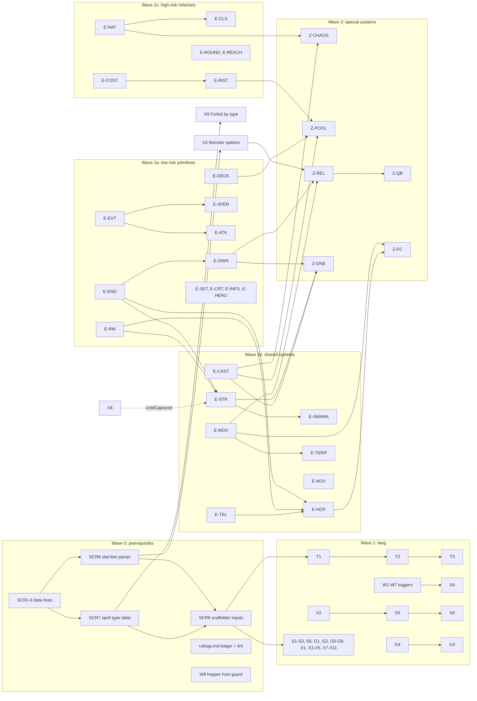

# Cross-house card roadmap

Synthesis of the ten house research docs (`docs/houses/<house>.md`, scraped 2026-10-16) plus the War/Life backlog
(`docs/superpowers/plans/cards-backlog.md`). Goal: all 510 scraped cards + the 24 backlog cards playable, on top of the
78 shipped War/Life cards (612 in total). Documentation only; nothing here is implemented. The War/Life plan
`docs/superpowers/plans/2026-10-17-remaining-cards.md` did not exist when this was written; section 3.6 maps the 24
backlog cards onto this roadmap's feature ids so the two can be reconciled.

Class legend (same in every house doc): **A** existing keywords only; **B** lang-layer addition only; **C** engine
feature; **D** special/hard. Feature ids below (T, S, W, G, X = lang; E-* = engine; Z-* = special systems; SCR = scraper;
UI) replace the per-house ids (each house numbered its own L1/F1/E1/C1...). House abbreviations: Ab Abomination, Bo Body,
De Death, Ds Despair, Ho Hope, Ju Justice, Ma Making, Mi Mind, Na Nature, Un Unmaking, BL War/Life backlog.

## 1. Totals

| House | Site id | Mana (prim/sec) | Nation | Cards | A | B | C | D |
|---|---|---|---|---|---|---|---|---|
| Abomination | 10 | Will/Strife | Imp | 50 | 8 | 23 | 17 | 2 |
| Body | 6 | World/Mystery | Cyclops | 52 | 12 | 25 | 14 | 1 |
| Death | 8 | Mystery/Will | Keeper | 52 | 11 | 24 | 13 | 4 |
| Despair | 9 | Mystery/Strife | Shadow | 51 | 5 | 28 | 15 | 3 |
| Hope | 3 | Clarity/Order | Vision | 50 | 8 | 17 | 22 | 3 |
| Justice | 5 | Order/Mystery | Gargoyle | 51 | 7 | 19 | 22 | 3 |
| Making | 1 | Order/Will | Dwarf | 50 | 12 | 24 | 13 | 1 |
| Mind | 12 | Will/Clarity | Djinn | 51 | 8 | 19 | 23 | 1 |
| Nature | 4 | World/Order | Satyr | 51 | 12 | 25 | 13 | 1 |
| Unmaking | 7 | Strife/World | Misfit | 52 | 7 | 23 | 19 | 3 |
| **10 houses** | | | | **510** | **90** (18%) | **227** (45%) | **171** (34%) | **22** (4%) |
| War/Life backlog | | | | 24 | 0 | 5* | 15* | 4* |
| **All pending** | | | | **534** | **90** | **232** | **186** | **26** |

\* Backlog classes are this roadmap's (the backlog file groups by engine extension, not by class): lang-only Challenge,
Cannon, Flaming Arrows, Cadre, Lava Flow; D = Questing Beast, Growing Strife, Greater Clarity, Seelie Court.

Reading: **90 cards are free** (keyword declarations + faces only); **317 (62%) need no engine change at all** (A+B);
186 need at least one engine primitive; 26 need a special system. Nine nations already exist in `nations.ts`, so no
house needs a nation before its A cards ship.

Near-duplicate patterns (same composition as a shipped card) recur in every house: "+1 <mana> each turn" globe
alterations (Point of Clarity shape: Cauldron of Strife, Balance of Mystery, Cenotaph of Will, Augur of Strife,
Threshold of Order, Rite of Mystery, Oculus of Will, Focus of Clarity, Sign of Order, Source of World), "0+5 town
generators" (Will to Power, Necropolis, Citadel, World Dance, Astronomic Clock, The Star Chamber), six "Burst of X"
cards, Court Politics clones (Slave Labor, Abstention, Preservation, Xenological Study), `When.created` town
helpers (Changelings, Farm-Boys, Master Armorer, Master Smith, Master Bowyer). Write these as one batch per pattern.

## 2. Feature catalogue (de-duplicated)

Per-house columns count cards that need the feature (a card needing several features is counted under each; counts
are from the house docs, +-1). "Risk" = regression risk to shipped code: **L** isolated new code; **M** touches a shared
path with opt-in behaviour; **H** touches every recruit, the stat pipeline, combat, movement or the hand/deck shape.
Old ids show which house-doc ids were merged.

### 2.1 Lang layer (Wave 1)

| Id | Feature | Ab | Bo | De | Ds | Ho | Ju | Ma | Mi | Na | Un | BL | Σ | First cards | Deps | Risk | Merged from |
|---|---|---|---|---|---|---|---|---|---|---|---|---|---|---|---|---|---|
| T1 | `Target.minion`, `Target.monster`, `Target.monsterGroup` builders (engine `TargetType` already has them) | 8 | 4 | 7 | 7 | 1 | 4 | 1 | 6 | 5 | 8 | 0 | **51** | Venom'd Arrow, Stupefy, Power, Carapace, Barkskin | none | L | Ab L1, Bo F1, De L1, Ds L1, Ho F1, Ju F1, Ma L2, Mi F1, Na L13, Un F1 |
| T2 | Group/structure/minion modifiers: `.notInStructure({persistent})`, `.inStructure`, `.minSize/.maxSize`, `.unoccupied`, `.neutral/.nonNeutral`, `.townOnly`, `.canAddRecruits`, `.withHandAttacks`, `.undamaged`, `.nation(n)`, structure kind OR ("friendly town or any colony") | 5 | 4 | 1 | 4 | 6 | 3 | 3 | 4 | 2 | 2 | 2 | **36** | Sword of Zana, Accursed Minion, Big Rock, Bleak Isle, Mitosis | T1 | L | Ab L1, Bo F1, Ds L1, Ho F1, Ju F1, Ma L2, Mi F1, Na L8, Un F1 |
| T3 | Square modifiers: `.near(terrain)` ("cast within a 3x3 diamond", RULING-X1), `.notNear('structure')`, `.adjacentTo('friendlyStructure')`, multi-terrain `.on(a,b,..)`, `.afterTurn(n)`, `.adjacentTerrainNot(t)`, `.noAdjacentEnemies` | 0 | 2 | 0 | 0 | 4 | 1 | 3 | 1 | 1 | 0 | 1 | **13** | Blue Auk, Giant, Griffin, Pegasus, Golem | SCR3 | L | Bo F1, Ho F1, Ju F1, Ma L2, Mi F1, Na L13 |
| T4 | `PiercesConcealment()` (sets existing `CardDef.ignoresConcealment`) | 0 | 0 | 1 | 0 | 0 | 0 | 0 | 0 | 1 | 1 | 0 | **3** | Dehydration, Biting Wind, Destroy Creation | none | L | De L9, Na L13, Un F1 |
| S1 | Group-relative scopes: `hostGroupOthers`, `targetGroupOthers`, `hostGroupMostHurt(recruit?)`, `targetGroupRandomOther`, `targetGroupOtherRecruits`, `targetRandom` | 8 | 0 | 0 | 2 | 0 | 0 | 1 | 0 | 0 | 2 | 0 | **13** | Carbuncle, Cannibalism, Albatross, Trebuchet | none | L | Ab L2, Ds L7/L2, Ma L1, Un F11 |
| S2 | Random-opponent scopes: `randomOpponent` (+`{nation}`, `{per:'archer'}`), `randomEnemy` (board), `opponentStrongest` | 1 | 1 | 1 | 2 | 0 | 0 | 1 | 1 | 1 | 0 | 0 | **8** | Banshee, Giant, Nihil's Touch, Foresight, Jade Dragon | none | L | Ab L2, Bo F4, Ds L2, Ma L7, Mi F2, Na L13 |
| S3 | Board/set scopes: `allMonsters`, `allMonsterGroups`, `friendlyRecruits`, `allNation:<n>`, `targetUnenchanted`, `opponentHeroes` (needs E-EVT hero flag) | 3 | 1 | 2 | 0 | 2 | 1 | 0 | 0 | 0 | 0 | 0 | **9** | Putrefaction, Wild Plague, Olotus, Aurora, Exile | none | L | Ab L2, Bo F4, De L7, Ho F5 |
| S4 | Event-context scopes: `killer`, `attacker`, `victimGroup`, `enterer`, `killerFirstSwordsman`, amount `eventAmount` | 0 | 1 | 0 | 0 | 2 | 2 | 3 | 2 | 0 | 2 | 0 | **12** | Combustioneers, Deflection, Retribution, Jinx | W4, W6 | L | Ho F5, Ju F3, Ma L5, Un F10 |
| S5 | Occupant/area scopes: `squareOccupants`, `structureOccupantGroup`, `ring8`, `adjacentOccupants`, `areaOccupants(shape)`, `adjacentFriendlyRandom` (once-filter before pick) | 0 | 0 | 0 | 3 | 1 | 0 | 2 | 2 | 2 | 3 | 0 | **13** | Hailstorm, Seal of Djai, Fingle, Panic, Field Armorer | X2 shapes | L | Ds L3/L9, Ma L1, Mi F2, Na L2, Un F7 |
| S6 | Created-class scopes `createdArchers`, `createdSwordsmen` | 0 | 0 | 0 | 0 | 0 | 0 | 2 | 1 | 0 | 0 | 0 | **3** | Master Smith, Master Fletcher, Master Bowyer | none | L | Ma L1, Mi F2 |
| W1 | `When.endOfCombat` (`combat:end`) | 3 | 0 | 1 | 0 | 1 | 0 | 0 | 0 | 0 | 0 | 0 | **5** | Cannibalism, Sawbones, Zana's Blessing | none | L | Ab L3, Ho F5 |
| W2 | `When.onKill` (`attacker:kills`) | 1 | 0 | 1 | 0 | 0 | 0 | 0 | 0 | 0 | 0 | 1 | **3** | Demon's Tongue, Curse of Khobai, Book of War | none | L | Ab L3, De L15 |
| W3 | `When.dying` + `Revive`/`CancelDeath` (heal before `cancel()`) | 1 | 0 | 3 | 0 | 1 | 0 | 0 | 0 | 0 | 1 | 0 | **6** | Reanimate, Larval Imp, Ergotism, Necromancer | none (dying-cancel exists) | M (mid-attack revive) | Ab L3, De L5, Un F10 |
| W4 | Death triggers on host: `When.dies`, `When.killed(by?)`, `When.groupDies`, `When.diesInCombat`; `Trophy(helper)` keyword (lift Wyrmling's Script) | 1 | 1 | 0 | 1 | 3 | 2 | 2 | 0 | 2 | 2 | 1 | **15** | Hero's Legacy, Ancient King, Minotaur, Uproot, Obsidian Dragon | none (retires Incarnate's Script) | L | Ho F5, Ju F19, Ma L5, Na L5, Un F10 |
| W5 | Phase/movement triggers: `When.afterMovement`, `When.beforeCombat`, `When.enter({into:'structure'})`, `When.moves` with `moveFrom/moveTo` | 1 | 1 | 1 | 0 | 0 | 0 | 4 | 0 | 0 | 1 | 0 | **8** | Implosion, Juggernaut, Gnome, Sand Sphinx | X2 areas | L | Ab L3, Ma L6, Un F10 |
| W6 | Victim-side combat triggers: `When.hit` (`attack:hit`), `When.damaged` (`armor:after`, damage>0, attacker set), `When.beforeArmor` (RULING-X13: lang only) | 0 | 0 | 0 | 0 | 1 | 3 | 2 | 1 | 0 | 1 | 0 | **8** | Retribution, Deflection, Fuligin, Aurora, Treacherous Armor | S4 | L | Ho F5, Ju F3, Ma L5, Un F10 |
| W7 | Conditional triggers: `startOfCombat({vs, opponentIn})`, `eachRound(n,{vs})`, `manaPhase({parity})`, `every:N`, `If(pred, ...)`, turn windows (`FromNextTurn`, `turns:[..]`) | 4 | 2 | 0 | 3 | 0 | 0 | 2 | 1 | 1 | 0 | 1 | **14** | Willing Supplicants, Nereid's Curse, Siege Engine, Alchemy, Cannon | none | L | Ab L6, Bo F4, Ds L12, Ma L7, Mi F3, Na L11 |
| W8 | Hopper host guard: an `Ambush` card's triggers must not fire from its globe controller copy | 0 | 1 | 0 | 0 | 0 | 0 | 0 | 1 | 0 | 0 | 0 | **2** | Brown Striders, Loch Dweller (latent in Arboriads, Firewyrm) | none | M (bug fix in shipped path) | Bo F4/K4, Mi F5 |
| G1 | Token stat helpers: `Grow(stats, trigger, {current})`, `TokenGrant`/`GiveTokens` (undispellable one-off stat changes), `Counter`/`Decay` self-ticking helpers | 6 | 0 | 1 | 5 | 0 | 0 | 0 | 0 | 0 | 2 | 0 | **14** | Soul Eater, Devouring, Atrophy, Frostbite, Magnetic Accrual | none | L | Ab L4, Ds L13, Un F4 |
| G2 | `GrantTo` additions (`'recruits'`, `'monsters'`, except-houses) and terrain-gated grants `While(terrain, ...)` | 0 | 0 | 2 | 1 | 0 | 0 | 1 | 0 | 0 | 1 | 0 | **5** | Lethargy, Stronghold, Haunted Forest, Harmattan | none | L | De L11/L12, Ds L6, Ma L1 |
| G3 | `Aura` extensions: `walks`, `concealed`, `noDamage`, aura `Against` by nation; pattern "Grant on card + Aura on helper" | 0 | 5 | 0 | 0 | 0 | 0 | 0 | 0 | 2 | 1 | 0 | **8** | Shaman's Walk, Visionary, Watersniper, Chaos Fog | G4 | L | Bo F3, Na L13, Un F1 |
| G4 | `Against` by victim nation / class / location + host-nation condition | 1 | 1 | 0 | 1 | 1 | 0 | 1 | 0 | 0 | 0 | 2 | **7** | Bilious Rage, Piercing Rays, Phantom, Cadre, Flaming Arrows | none | L | Ab L7, Ds L4, Ho F17 |
| G5 | One damage-reception keyword `Resist({kind, from, amount\|set, when:'beforeArmor'\|'afterArmor'})` covering Warded variants, NoMissileDamage, Deflect, DamageFrom (+1 from Shadows), Invulnerable, Reflect | 2 | 2 | 3 | 3 | 2 | 4 | 0 | 2 | 1 | 0 | 0 | **19** | Skeleton, Despond, Golem, Mark of Ulanoth, Mirrored Armor | refactor `Warded` onto it | L-M (Warded shipped) | Ab L7, Bo F4, De L4, Ds L4, Ho F8, Ju F11, Mi F4, Na L12 |
| G6 | `Gaze`-style `Threshold(n, Kill())` (count copies of a helper) + `NoDamage()` static | 0 | 0 | 0 | 3 | 1 | 0 | 0 | 0 | 0 | 1 | 0 | **5** | Gorgon, Shield of Vela, Cockatrice, Blindness | RULING-X6 | L | Ds L6/L13, Ho F13, Un F4 |
| G7 | Dynamic amounts: `Damage({stat})`, `Damage({min,max})`, computed damage (`2 x size`), `GrantPer(count, delta)`, `AddDamage` | 2 | 0 | 1 | 0 | 0 | 0 | 1 | 0 | 1 | 3 | 0 | **8** | Dissention, Erisian Blade, Minefield, Earthquake, Pyre | none | L | Ab L7, Ma L1, Na L13, Un F4 |
| G8 | `Wereform(name, delta, keywords, opts)` + `ImmuneTo(cardIds)` | 0 | 4 | 0 | 0 | 0 | 0 | 0 | 0 | 0 | 0 | 0 | **4** | Bear/Eagle/Lion/Lizard Spirit | UI form display | L | Bo F2 |
| X1 | One `Dispel(scope, {kinds, random, first, exceptSelf})` replacing `DispelAll` (keep alias): minion individual, structure, square, globe, diamond, victim(+group), enterer, opponent group, everything | 2 | 2 | 3 | 2 | 1 | 3 | 3 | 3 | 3 | 7 | 0 | **29** | Winnowing Sigil, Abatement, Wrack, Yfreet, Second Chance | Colony helper rule (RULING-X17) | L-M (Cleansing Light shipped) | Ab L7, Bo F4, De L3, Ds L11, Ho F6, Ju F16, Ma L1, Mi F2, Na L3, Un F2 |
| X2 | Terraform shapes/maps: `diamond(r)` (Chebyshev, RULING-X1), `adjacent`, `randomAdjacent(n)`, `randomSquare`, `hostSquare`, `edge(2)`, `besideTerrain(t)`, `everywhere(from)`, `TerraformMap`/`Degrade`, `TerraformRandom(list\|contiguous)`, terrain move (Tornado), staged chain (Drought), timed revert (Deluge, Lava Flow) | 2 | 2 | 4 | 2 | 1 | 0 | 4 | 0 | 7 | 2 | 1 | **25** | Wasteland, Savannah, Seed on the Wind, Blight, Lode Star | none | L | Ab L7, Bo F4, De L2, Ds L8, Ho F6, Ma L6, Na L2, Un F11 |
| X3 | `Monster` options: `count`, count range, multi-def, `square:'random'`, `becomes` (canCast after terraform), `control:'player'`, bot `MovesTwice` | 2 | 1 | 2 | 2 | 3 | 0 | 4 | 0 | 5 | 1 | 0 | **20** | Legion of the Dead, Trolls, Wolf Pack, Homunculi, Centaurs | faces snapshots | L | Ab L7, De L6, Ds L5, Ho F8, Ma L4, Na L1, Un F11 |
| X4 | `Create` options: square target, `into:'everyRecruitGroup'`, `randomClass/randomNation`, house override, `withGroup`, per-helper duration in `with`, trigger-time `CreateIn`, `AddRecruit(bySize)`, `Garrison` | 0 | 1 | 0 | 0 | 3 | 0 | 2 | 0 | 1 | 3 | 0 | **10** | Heartsong, Spiritual Advisers, Utaban Brothers, Ort, ThudThud | none | L | Bo F4, Ho F6, Ma L8/L9, Na L8, Un F11/F16 |
| X5 | `Novices` options: host structure inside a trigger, all caster structures, caster Sanctum, per member | 0 | 1 | 0 | 0 | 2 | 0 | 0 | 0 | 0 | 0 | 0 | **3** | Fertility, Chalice of Hope, Recall | none | L | Bo F4, Ho F6 |
| X6 | Movement effects: `MoveTwice(scope)`, `CancelMove('target'\|'host'\|'casterGroups')`, `RandomMove({excludeOrder, allowStay, unoccupied}, scope)`, `SwapInitiative`/initiative effects (`ctx.setInitiative` exists) | 1 | 0 | 1 | 3 | 0 | 0 | 1 | 2 | 2 | 3 | 1 | **14** | Disorient, Gale Force, Meditation, Horsing Around, Challenge | S5 | L | Ab L7, De L14, Ds L9/L10, Ma L1, Mi F2, Na L7, Un F7 |
| X7 | Mana variants: `AddMana` to `both`/`occupantOwner`/`hostOwner`, amount `perNovice`, type `structureType`, `NationMana`, `CycleTownMana`, negative amounts + clamp at 0 after `mana:generate` (engine one-liner), `Tally`/`PayTally` next-turn pools, shared `Burst(mana,n)` | 4 | 0 | 2 | 0 | 2 | 1 | 1 | 4 | 1 | 1 | 0 | **16** | Alchemy, Song of the Doomed, Maloch's Pact, Prophet, Panopticon | none | L | Ab L5/E13, De L19, Ho F6, Mi F3, Na L11, Un F17 |
| X8 | Lifetimes: `OnExpire(effects)`, `ResetDuration(n)`, `Arms(n)`, `Fleeting()` on minion and structure hosts (RULING-X15), `NextRoundOnly`, `UntilCaptured()` (needs E-STR event) | 0 | 0 | 2 | 1 | 2 | 1 | 4 | 2 | 4 | 3 | 0 | **19** | Touch of Death, Karillian Arrows, Dwarven Airship, Census, Flail of Sar'ul | E-STR for UntilCaptured | L | De L13/L18, Ho F18, Ju F10, Ma L1/L7, Mi F4, Na L4 |
| X9 | Casting restrictions: `OnlyOne({perPlayer})` (RULING-X19), `Forbid` by spell type / `square` class / cost (`casterSecondary`) / who / turn window / target area | 0 | 1 | 0 | 1 | 2 | 11 | 1 | 3 | 0 | 0 | 0 | **19** | Intercession, Prohibition, Law of the Land, Xenological Study, Shield of Vela | SCR7 (spell types) | L | Ho F13, Ju F2/F17, Ma L3, Mi F4 |
| X10 | Targeting protection: `Shroud({against:'enemy'})`, `Shroud` hosted on a structure (protects occupants) and `from:['structure']`, `Immune(houses,{group, kinds})`, square `Sanctuary()`, `Concealment({from:'opponent'})` | 3 | 6 | 2 | 0 | 1 | 1 | 4 | 1 | 3 | 2 | 0 | **23** | Raven Shroud, Domed City, Stone Circle, Beobogh's Helm, Dracha's Decree | none | L | Bo F4, De L10, Ho F6, Ju F15, Ma L3, Na L6/L13 |
| X11 | Misc effects: `GiveGroup(card, scope)`, `CastOn(helper,'globe')`, `SetHp(n)`, `Spawn(def,{every})`, `Attracts` (extract Undine; RULING-X12), `OneOf([...])` | 2 | 0 | 3 | 4 | 0 | 0 | 2 | 2 | 0 | 3 | 0 | **16** | Nightmare, Harm Monster, Neb's Mirage, Mirage, Ort | none | L-M (Undine refactor) | Ab L7, De L8/L16, Ds L3, Mi F4, Un F11 |

### 2.2 Engine primitives (Wave 2)

| Id | Feature (exact change) | Ab | Bo | De | Ds | Ho | Ju | Ma | Mi | Na | Un | BL | Σ | First cards | Deps | Risk | Merged from |
|---|---|---|---|---|---|---|---|---|---|---|---|---|---|---|---|---|---|
| E-RM | Remove from game: `ctx.remove(minionId)`, `ctx.removeGroup(gid)` = `killMinion(...,'removed')` (exists, unexposed); `ctx.replaceGroup(gid, specs)` and `ctx.replaceMinion(id, spec)` (keeps group spells, Pipelines_death) with new ids so later same-turn spells squander | 3 | 2 | 3 | 1 | 6 | 3 | 2 | 1 | 2 | 6 | 0 | **29** | Ascension, Furies, Volgaris, Devolution, Jade Dragon | none | **L** (win-win) | Ab E3, Bo F5/F10, De C1, Ho F2, Ju F14/F21, Ma E6, Na C1, Un F5, Ds E12 |
| E-END | `CardDef.onEnd` (runs on expire **and** dispel; today only `onExpire`) + `onDispel` | 1 | 1 | 0 | 0 | 0 | 0 | 1 | 1 | 1 | 0 | 1 | **6** | Possession, Lycanthropy, Lost Mine, Smell the Roses, Encampment | none | L | Ab E4, Bo F10, Ma E6 |
| E-OWN | `ctx.setOwner(gid, red\|blue\|neutral)` (generalise `flipGroup`; groupSeq, minion owners; RULING-X10 for spell owners), `ctx.setControl(gid, player\|computer, botId)` with revert | 3 | 0 | 0 | 1 | 2 | 2 | 0 | 2 | 2 | 0 | 2 | **14** | Rogue Monster, Betrayal, Domesticate, Emancipation, Renegades | E-END | M-H (owners, bots, `control`) | Ab E4, Ho F10, Ju F14, Mi F8, Na C5 |
| E-EVT | Event visibility: group-mother `groupEvents:true` (spell on a member hears group-mates' minion events), global `hears:[...]`, `inCombat` on death events + `group:dies`, `Minion.hero` flag, `ctx.kill/damage(..,{blame})` (RULING-X5) | 2 | 1 | 6 | 1 | 0 | 1 | 0 | 1 | 0 | 0 | 0 | **12** | Necromancer, Khobai, Keeper Code, Assassin, Sar'uli Overseer | none | M (opt-in flags keep old chain order) | De C3-C6, Ds E11, Mi F17, Ab E15 |
| E-SET | Stat "set" layer applied after deltas: `maxHpSet`, `levelSet`, `levelCap`, `noExp`, `armorZero`; death at max HP 0; level grant / experience award API | 0 | 0 | 1 | 1 | 1 | 1 | 0 | 1 | 0 | 1 | 1 | **7** | Curse of Khobai, Unicorn Herd, Obeisance, Nihil's Minion, Gatemouth | none | M (computeStats tail) | De C7, Ds E14, Ho F14, Ju F12, Mi F14, Un F4 |
| E-XFER | `ctx.transferSpell(spellId, host, owner?)` before burial; "group wiped in combat, blamed group" data | 1 | 0 | 0 | 0 | 1 | 0 | 0 | 0 | 0 | 2 | 0 | **4** | Jinx, Atonement, Scars of Kolekh, Jumping Land | E-EVT blame | L | Ab E7, Ho F15, Un F12 |
| E-ATK | Attack flags: `ignoresArmor`, `alwaysHits`, dodge (`attack:wouldHit`), magical attacks / strike-time magical, damage redirect (Whipping Boy, Brother Wolf), combined attack, healing attacks, friendly-fire victim chooser | 0 | 2 | 0 | 3 | 5 | 0 | 1 | 0 | 0 | 0 | 2 | **13** | Spirit Sword, Deva's Quiver, Phantom, Master Fletcher, Yeoman | E-EVT (redirect needs mother events) | **H** (combat.ts) | Bo F11/F16, Ds E9/E11, Ho F3, Ma E2 |
| E-CRT | Creation events: `summon`/`addMinion` dispatch `minion:created` (+ re-entrancy guard), `group:created` | 0 | 3 | 0 | 0 | 1 | 0 | 0 | 1 | 1 | 0 | 0 | **6** | Jungle, Primeval Forest, Volunteers, Nomadic Tribe, Awaiting | none | M (existing `When.created` cards see more events) | Bo F6, Ho F12, Mi F11, Na C2 |
| E-DECK | Hand/deck ops: `discardHand`, `addToDeck(top\|bottom\|random)`, `peekDeck`, `reorderDeck`, `removeTopOfDeck`, `blocksDraw`, `blocksDiscard`, `discardedThisTurn`, `returnToDeck` | 1 | 0 | 1 | 1 | 3 | 3 | 2 | 2 | 0 | 1 | 1 | **15** | Leap of Faith, Wild Abandon, Injunction, Quantum Mechanic, Day of Mourning | none | M (hidden info in view) | Ab E10, De C9, Ds E8, Ho F9, Ju F6, Ma E5, Mi F7, Un F14 |
| E-INFO | Private `ctx.tell(side, payload)` + public reveal log, filtered by `view.ts` | 0 | 0 | 0 | 0 | 0 | 0 | 0 | 3 | 0 | 1 | 1 | **5** | Farseeing, Revelation, Al Hakim, Jester at Court, Spy at Court | UI | M (state leak) | Mi F6, Un F14 |
| E-STR | Structure lifecycle: `createStructure(kind, owner, pos, {noNovices})` + Colony helper, `destroyStructure`, `capture(st, side)`, `structure:captured` event + recheck, kind change, relocate, `flamedOut`, deferred mana choice | 1 | 1 | 2 | 0 | 5 | 4 | 1 | 4 | 1 | 3 | 4 | **26** | Found City, Settlement, Civilize, Gogar's Wrath, Encampment | E-RM, E-END | **H** (initiative delta, pendingMana, novices, saves) | Ab E8, Bo F12, De C8, Ho F4, Ju F8, Ma E7, Mi F9, Na C10, Un F9, BL E8 |
| E-SMANA | `structure:mana` cancellable/editable event before base mana, `mana:after` (strictly last), mana re-choice prompt | 2 | 0 | 0 | 1 | 0 | 1 | 0 | 3 | 0 | 0 | 0 | **7** | Civil Unrest, Corrosion, Djinni Debate, Transubstantiation | E-STR (captured) | M | Ab E1, Ds E5, Ju F8, Mi F10 |
| E-NOV | Novices as per-novice nation list; `novice:created` (editable nation, cancel, replace); `removeNovices/setNovices`; production block | 3 | 0 | 0 | 1 | 0 | 1 | 0 | 1 | 0 | 1 | 0 | **7** | Pestilence, Djibari's Legacy, Insurrection, Census, Kumatru Academy | none | M-H (training, capture, UI, saves) | Ab E2, Ds E7, Ju F10, Mi F14, Un F9 |
| E-MOV | Movement: `rooted` stat (beats every move source), group lock `noJoin/noAdd/noStructures`, destination hooks `allowsEnter/blocksEnter/blocksMove`, owner `terrainOverride`, pre-enter `group:entering`, bot-order override event, moving attract area | 1 | 1 | 0 | 4 | 4 | 6 | 1 | 3 | 2 | 1 | 4 | **27** | Complacency, Fear, Binding Cube, Mountain Pass, Ostracize | none | **H** (`canEnterSquare`, `groupCanEnter`, `legalDirs`, bots must agree) | Bo F7, Ds E2/E4, Ho F7, Ju F9, Ma E8, Mi F12, Na C5, Un F15, BL E1 |
| E-TEL | `ctx.teleport(gid, pos)` (no move events, fatal check deferred, Elements_terrainswalks), `leaveGroup`, `exchangeMinions`, exported random-square picker | 1 | 2 | 1 | 1 | 1 | 0 | 0 | 2 | 0 | 3 | 0 | **11** | Bolt of Somersaults, Outcast, Ch'tai Exchange, Furies, Fiend | none | M | Bo F8, Ds E13, Ho F11, Mi F13, Un F8 |
| E-HOP | Boardhop containers: exit square, timer, return when exit free, into structures, removed if dispelled; lang `Boardhop({turns})` | 0 | 1 | 1 | 0 | 2 | 0 | 2 | 1 | 1 | 0 | 3 | **11** | Will o' the Wisp, Lost Mine, Vision Quest, Soul Jar, Awaiting | E-RM, E-END, E-TEL | M | Bo F9, Ho F11, Ma E6, Mi F11, Na L9, BL E6 |
| E-CAST | Spell lifecycle: `spell:cast` on the target ref (bubbles to globe; RULING-X7), `fromHand`, execution-only `interceptCast`, `spell:squandered`, `spells:before` + squander-a-cast, `castAsHelper(cardId, target, owner)`, `bannedCards` | 1 | 0 | 1 | 0 | 1 | 7 | 1 | 3 | 0 | 1 | 1 | **16** | Gilt, Trump, Beast's Embrace, Empathy, Waste Not | X9 types | M (`castCheck` split ordering vs execution) | Ab E5, De C9, Ho F16, Ju F5/F20, Ma E5, Mi F16/F19, Un F14 |
| E-COST | `costDelta` hook + `effectiveCost(side, card)` used by `validateOrders`, executeCast, UI; floor 0 per type | 0 | 1 | 0 | 1 | 0 | 1 | 2 | 0 | 1 | 0 | 0 | **6** | Syzygy, Dissolution, Codex of Order, Theralda, Ogi | UI | M-H (orders validation) | Bo F14, Ds E6, Ju F7, Ma E3, Na C9 |
| E-INST | Card instances: `hand/deck: {cardId, tokens, costOverride, house}`; Revolver tick at `turn:start`; Recursive copy (+1 token, +1 primary); transmute; instance tokens reach `ActiveSpell`; duration from paid cost | 1 | 1 | 2 | 0 | 2 | 0 | 2 | 3 | 1 | 1 | 2 | **15** | Biting Wind, Pinnacle of Order, Worldwalking, Growing Strife, Memorize | E-COST | **H** (`PlayerState.hand: string[]` everywhere) | Ab E11, Bo F15, Ho F19, Ma E4, Mi F7, Na D1, Un F18, BL E10 |
| E-NAT | Nation as a computed stat: stop baking HP/walks into `base` (`applyNation`), `StatDelta.nation` override, `noNation`, `ctx.setNation`, `ctx.transform`; `house` stored, overwritten on nation change (RULING-X9); terrain recheck | 2 | 0 | 0 | 3 | 0 | 0 | 0 | 0 | 1 | 3 | 1 | **10** (+5 via Z-CHAOS) | Penumbra, Larval Imp, Forbidden Ichor, Revelers, Fae Gift | none | **H** (every recruit) | Ab E6, Ds E1, Na C7, Un F6 |
| E-CLS | Computed / dual class (`Stats.cls` override, `alsoCls`), class recheck | 0 | 0 | 0 | 1 | 0 | 0 | 0 | 1 | 0 | 0 | 1 | **3** | Cruel Whim, Rakshasa, Weapon Master | E-NAT (same refactor) | H | Ds E10, Mi F18 |
| E-ROUND | Combat round visible to `stats` (`state.combat.round`), `Grant({..},{round})`, round-1 hand attacks | 0 | 0 | 2 | 0 | 0 | 0 | 3 | 0 | 1 | 0 | 0 | **6** | Fusillade, Reaper, Garrote, Loose Bearings, Warhammer | none | **H** (computeStats in combat) | De C2, Ma E1, Na C3 |
| E-REACH | Area reach: `CardDef.reach(q, spell, pos)` consulted by `chain()` and `computeStats()` | 0 | 0 | 0 | 0 | 0 | 0 | 0 | 0 | 2 | 0 | 2 | **4** | Eagle Eyes, Ill Winds, General, Fae Quadrille | none | **H** (two hottest paths) | Na C6, BL E11 |
| E-TERR | Terrain rules: swamp exit (RULING-X11), ice sliding, realm terrain roll in ctx | 1 | 0 | 0 | 2 | 0 | 0 | 0 | 0 | 3 | 2 | 0 | **8** | Swamp Land, Freeze, Ice Age, Water's Gift, Geomancy | E-MOV (`rooted` vs slide) | M-H (mapgen swamps already in every game) | Ab E9, Ds E3, Na C4/C8, Un F13 |
| E-HERO | Hero once-per-game keyed by hero identity, not card id | 0 | 1 | 0 | 0 | 0 | 0 | 0 | 0 | 0 | 0 | 0 | **1** | Oro (vs Vlad Hrothgar) | owner decision O1 | L | Bo F19 |

### 2.3 Special systems (Wave 3)

| Id | System | Cards | Deps | Risk |
|---|---|---|---|---|
| Z-CHAOS | Chaos Feature: pool of real individual alterations/conjurations (sorted by id, `canCast` on the minion), cast as helper; undispellable mark counter; 3 marks -> Misfit | Un: Chaos Feature, Bedlam, Gnax, Gyre (+E-INST), Hollow Jester, ThudThud's Journey (6) | E-NAT, E-CAST castAsHelper, E-MOV noAdd, E-RM | M (behaviour changes as houses land; tests stub the pool) |
| Z-POOL | Random card pools + transmuted inserts: random summoning by square legality, random spell by total cost, random enchantment generator | Ho Inspiration; Mi Bestiary, Itrokos Gate, Narh'u'ha; Un Instability; Bo Cessao Rift (6) | E-DECK, E-INST, E-CAST, E-RM | M |
| Z-REL | Relation monsters: host-group link, bereavement, hunter/patrol bots, random edge/adjacent spawn, side switching, player-controlled monsters, Moves 2 | Ju Alabaster Guardian, Tindelhunden; BL Questing Beast (3) | E-OWN, E-MOV, E-RM, X3 | M-H (bots) |
| Z-QB | Questing Beast: Z-REL + hunted group out of player control + "dies unless free (*)" check | BL (1) | Z-REL | H (undefined asterisk, RULING-T8) |
| Z-FC | Faerie Circle: boardhop on forest, random 1-5 turns, Faerie Blessing "cannot re-enter" | BL (1) | E-HOP, E-MOV blocksEnter | M |
| Z-ONE | Hard one-offs: Zana (continuous monster ownership override), Slavers, Odar (friendly fire + flip when alone), Jade Gargoyle (spell copy), Nihil (curse text unknown), Seelie Court (structure off board) | 6 | E-OWN, E-CAST, E-ATK, E-RM, E-HOP, E-STR | H each |

### 2.4 Scraper and UI layers

| Id | Layer | Feature | Needed by |
|---|---|---|---|
| SCR1-SCR9 | scraper | section 5 | Wave 0, all card writing |
| UI-COST | ui | effective cost in hand view (E-COST, E-INST) | Revolvers, cost modifiers |
| UI-INFO | ui | private notices + public reveal log (E-INFO) | Mind scrying, Jester at Court |
| UI-FORM | ui | spirit form name/stats from the controller spell token (G8) | Wereforms |
| UI-HAND | ui | instance tokens / overrides shown on hand cards (E-INST) | Recursive, transmute |
| UI-OWN | ui | player-controlled monster groups, computer-controlled recruit groups (E-OWN) | Domesticate, Smell the Roses, Rakshasa |

### 2.5 Conflicting rulings between house docs (decided here)

Each is a cross-house ruling to enter in `rulings.md` (section 6).

| Id | Topic | House positions | Decision | Why |
|---|---|---|---|---|
| RULING-X1 | "3x3 diamond" / "5x5 diamond" geometry | Ab R18, Bo R27, De 1, Ho R1: 9 squares (Chebyshev 1). **Na R1: 5 squares (Manhattan 1). Ma R11 Lode Star: Manhattan 2 (12 squares).** | NxN diamond = Chebyshev radius (N-1)/2: 3x3 = 9 squares, 5x5 = 25 (24 excluding the centre). Overrides Na (Natural Order, Seed on the Wind, Smell the Roses) and Ma (Lode Star). | Concepts_mothers: "the 9 squares in a 3x3 diamond"; Elements_squares: the board is drawn isometric so squares look like diamonds. |
| RULING-X2 | Burst of X (Will, World, Mystery, Clarity, Order, Strife) | Ab R7: visible, exclusive. Ma R6: visible, Stackable. **Bo R4, Ho R3: non-visible, Undispellable, cumulative.** Un R3: non-visible. De: Stackable. | One shared `Burst(mana, 2)` keyword: visible globe conjuration `Lasts(2)`, default exclusivity (no "may be cast more than once" on the card). | Literal rules: real spells cast from hand are visible; only cards that print "May be cast more than once" stack (Cauldron vs Burst). Owner may flip (O8). |
| RULING-X3 | Spell type of "Dispelled after next combat" without a Duration | **Ds R1 and De (Bolstering Spirit): conjuration.** Ab (Accursed Minion), Ho (Sword of Zana, Valiant Stand), Ma (Loose Bearings, Man-Catcher), Un (Rust), Na (Protective Cover): alteration. | Alteration. "Duration:" -> conjuration. | Shipped precedent: Faerie Fire, Rain of Arrows, Skirmish are alterations with that clause. |
| RULING-X4 | 3x3 / "adjacent" vs "eight surrounding" | Consistent, recorded once | "Adjacent" = 4 orthogonal (engine `ADJACENT`); "eight squares surrounding" = Chebyshev ring. | Elements_squares orthogonal/diagonal definitions. |
| RULING-X5 | Death category of ability kills | **"dies" (no blame):** De 7 (Dire Portent, Touch of Death, Assassin, Furies), Ds R7 Banshee, Ds R22 Gorgon's Gaze, Ma R7 Deflection, Ma R23 Siege Engine, Ho R30 Sword of Zana. **"kills" (blamed):** Ju 11 Retribution, Un R28 Cockatrice's Gaze, Ab R13 Doppelganger (wants E15). | **"kills" blamed on the host minion** for combat-triggered spell effects and monster special effects; "dies" only for instant-death spells and spell/terrain damage. Needs `ctx.kill/damage({blame})` (E-EVT). Gorgon and Cockatrice Gaze become identical. | Pipelines_death defines "kills" to include "Combat-triggered spell effects", "Monsters' special effects", weapon spells' extra magical damage. Shipped Shattering Blow follows "dies": owner decision O2 on retrofitting. |
| RULING-X6 | Gaze helpers | Gorgon's Gaze (Ds, Ho Shield of Vela) and Cockatrice's Gaze (Un) | Two helpers with separate counters (3 of the same kind kill); identical stats -1 H, -1 M, +1 A. | Different card names; "a minion who gets three or more Gorgon's Gaze". |
| RULING-X7 | What `spell:cast` sees | Ab E5: on target ref. Ma E5, Mi F16: untargeted. **Ju R22: Talisman counts Jade Gargoyle copies (helpers). Ab R6, Ma R5: helpers never count.** | Dispatch on the target ref (bubbles to the globe, so global listeners see every cast); only successful real casts **from hand** count ("subsequent alteration cast", Boret'hu, Memorize, Hapax, Gilt). Jade copies do not feed Talisman. | One rule for all "cast" listeners; helper casts are engine actions, not casts by a player. |
| RULING-X8 | Damage redirect blame (Whipping Boy, Brother Wolf) | **Ds R36: nobody blamed. Bo F11: attacker still blamed.** | Attacker blamed (redirected combat damage stays combat damage; a Wolf killed this way is a "kills" death). | Pipelines_death: non-magical combat damage = "kills". |
| RULING-X9 | A created minion's `house` | Ho R14 Heartsong (Imp, house Hope), Ju Ozande (Human, house Justice): house from the creating card. **Ds E1, Un R2, Ab R19: house derived from nation.** | `house` is stored: creator card's house at creation (trained recruits: nation's house), overwritten with the new nation's house on any nation change. | Keeps both lore cases and the rules' nation-change examples (Forbidden Ichor). |
| RULING-X10 | Spell owners on an ownership change | Ab risk note: `flipGroup` rewrites every spell owner; Ab R23 Possession reverts them. De R15 Raven Shroud, Elements_spells: "on friendly" persistent spells dispel on ownership change. | Spell owner = caster, never rewritten. Persistent "friendly" checks (Belvario's Horn, Raven Shroud, Scars of Kolekh, Touch of Death) then dispel on the next recheck. `flipGroup` changes (owner decision O7). | Rewriting owners makes those persistent requirements unfalsifiable. |
| RULING-X11 | Swamp exit | **Ab R32: group-specific (back toward the square the group entered from).** Un Mudslinging text: "most recent direction from which any group entered that swamp". | Square state: each swamp stores the direction of its most recent entry by any group; any group there may exit only that way (back out). Flight exempt (immune to adverse terrain). Groups that never entered by movement use the stored direction too; none stored = free. | Elements_terrainswalks wording is square-based. |
| RULING-X12 | Attract layer | De L16, Mi F4: lang keyword (extract Undine). **Ds E4: engine.** | Lang `Attracts` keyword (from Undine's script) for static squares (Neb's Mirage, Mirage); engine only for Siren Song's area that moves with its monster (E-MOV). Rooted groups are exempt (Mi). | Static attraction already works in Undine. |
| RULING-X13 | Victim-side combat triggers | **Ju F3: engine (new `attack:damaged`).** Ma L5: lang. | Lang only: `damage.ts` already dispatches `attack:beforeArmor`, `attack:hit`, `armor:after` on the victim ref with `attackerId` and `damage`. | Verified in `packages/engine/src/damage.ts`. |
| RULING-X14 | Boardhop layer | **Na L9: lang (hide/appear exist).** Ma E6, Mi F11, Bo F9: engine. | One engine container (E-HOP) + lang `Boardhop()`. Will o' the Wisp moves to Wave 2 with the rest. | "Removed if dispelled" and structure re-entry need engine support; one implementation for 11 cards. |
| RULING-X15 | `Fleeting` on non-group hosts | Na `UntilCombatEnd()`, Ma/Mi "minion-host Fleeting", Ho/De/Un "Fleeting on structures" | Extend `Fleeting()` to all hosts: minion = its group's next `combat:end`; structure = first combat fought by a group standing there. No new keyword name. | Same rule, three names. |
| RULING-X16 | "Dispelled if town is captured" | Ho `UntilCaptured()` persistent owner check (lang). **De C8, Mi F9: `structure:captured` event.** | Engine fires `structure:captured` and rechecks the structure in the capture loop; `UntilCaptured()` keyword listens to it. | A persistent check only runs on recheck; capture happens in `beginTurn`. |
| RULING-X17 | Colony helper vs dispel-all | Ho Perfection "colony helper exempt"; Na Natural Order (square only); Un R24 Unmagicking silent; Ds Pantogar's Failure silent. | Colony helper is a dispellable structure spell: any "dispels all spells on structure" destroys colonies (Pantogar's Failure, The Unmagicking, Leechwood-style untargeted dispels), except where the card says otherwise (Perfection, Natural Order). | Elements_structures: "any spell or effect that dispels all spells on a structure will automatically destroy a colony"; Unmagicking named there. |
| RULING-X18 | Ancestral Home relocation | Bo R20: novices, mana type, spells go with the town. Elements_structures: the engine "simulates movement by destroying the original one, and creating a new one". | Keep Bo R20 (spells and novices follow) so Ancestral Home can move more than once. | The card says the town moves on every training. |
| RULING-X19 | "Only one in play" naming and instants | Names: OnlyOne / OnlyOneInPlay / UniqueInPlay / OnePerPlayer. **De R3: second Apocalypse squanders. Un R24: moot.** | One keyword `OnlyOne({perPlayer?})`; no effect on manifestations (they never become active, Elements_spells). | Spell life stages. |
| RULING-X20 | "not in a structure" / "friendly" persistence | Bo R14 casting-time, Ju 25 Sentinel persistent, Ab Possession persistent, Ho Sword of Zana casting-time | Per-card table from Elements_spells: persistent for Belvario's Horn, Possession, Sentinel ("not in a structure") and Belvario's Horn, Raven Shroud, Scars of Kolekh, Touch of Death ("friendly"); casting-time otherwise. T2 takes `{persistent:true}`. | Not a true conflict; recorded once so cards do not drift. |
| RULING-X21 | Fear's "cannot be moved" | Ds R17 provisional (cancel orders only) vs Bo R14 Complacency full `rooted` | Hold Fear for E-MOV and ship both with `rooted` (one semantic for 6 cards). | Avoid a second retrofit. |
| RULING-X22 | `Target.minion` class of Nature cards | Na counts Barkskin, Jaguar's Blood, Lightning Bolt, Pixie Dust as A (raw `{type:'minion'}`); others count T1 cards as B | Use the T1 builder everywhere (Na's 4 move to "T1-only" but stay in the A starter set). | Uniform faces/printing. |

## 3. Dependency graph and global build order

### 3.1 Graph

### 3.2 Waves

Cumulative counts are cards playable in the game out of **612** (78 shipped + 534 pending). Task estimates assume one
plan task per feature (or per tightly related feature pair) plus one task per ~10-card batch of card declarations.

| Wave | Features | New cards | Cumulative | Est. tasks | Why this order |
|---|---|---|---|---|---|
| 0 | SCR1-SCR9, `rulings.md` + lint, W8 hopper guard, deck version equivalence map | 0 | 78 | 9 | Every card file reads the scraped data; wrong types/targets/stat lines would be copied 534 times. W8 is a latent bug in shipped hoppers. |
| 1a | The 90 A cards in pattern batches (section 1 near-dups) | 90 | 168 | 9 | Zero new code; faces only. |
| 1b | Win-wins: T1, X1, G5, X3, X2, S1-S3, T2 | ~120 | ~288 | 9 + 12 batches | Seven features unlock ~150 card-needs; all L risk. |
| 1c | Remaining lang: T3, T4, S4-S6, W1-W7, G1-G4, G6-G8, X4-X11 (+ mana clamp one-liner) | ~100 (incl. 5 backlog: Challenge, Cannon, Flaming Arrows, Cadre, Lava Flow) | ~388 | 14 + 10 batches | Rest of the B cards; ~12 B cards wait for Wave 2 (Fear, Volunteers, Octagon of Force, Will o' the Wisp, Earthquake colony clause, Rust, Valiant Stand, ...). |
| 2a | E-RM, E-END, E-OWN, E-EVT, E-SET, E-XFER, E-CRT, E-DECK, E-INFO, E-ATK | ~90 | ~478 | 11 + 9 batches | Small ctx actions and opt-in events; E-RM alone is 29 cards at L risk. E-ATK is the only H item here (isolated flags in `attack()`). |
| 2b | E-STR (+ backlog E8), E-SMANA, E-NOV, E-MOV, E-TEL, E-HOP, E-CAST, E-TERR | ~78 | ~556 | 12 + 8 batches | Shared systems with one design each; structures and movement are H risk but every later special system depends on them. |
| 2c | E-NAT, E-CLS, E-ROUND, E-REACH, E-COST, E-INST (Revolver, Recursive, transmute) | ~34 | ~590 | 8 + 4 batches | Refactors of the stat pipeline and hand shape: last, after the suite has 500+ cards of regression coverage. |
| 3 | Z-CHAOS, Z-POOL, Z-REL, Z-QB, Z-FC, Z-ONE | 22 | 612 | 9 + 3 batches | Cross-house pools must see the full card set; relation bots need every movement primitive. |

Total: ~130 plan tasks.

### 3.3 Win-wins vs risky

| Win-win (cheap, many cards) | Cards | Risky (touches hot paths) | Cards | Mitigation |
|---|---|---|---|---|
| T1 target builders | 51 | E-NAT computed nation | 10 (+6 Chaos) | Do once, all houses; run full War/Life suite; HP keeps damage taken |
| E-RM remove/replace | 29 | E-INST card instances | 15 | One shape change for hand+deck+orders+view+saves in one task; adapters for `string[]` consumers |
| X1 `Dispel` scopes | 29 | E-MOV restrictions/hooks | 27 | One helper used by `canEnterSquare`, `groupCanEnter`, `legalDirs`, bots; table tests per hook |
| X2 terraform shapes | 25 | E-STR structures | 26 | Capture-mid-turn + next turn start tests; initiative delta tests |
| X3 Monster options | 20 | E-ROUND / E-REACH | 6 / 4 | Opt-in per card (`roundAware`, `reach`); cache by square |
| G5 `Resist` | 19 | E-ATK combat flags | 13 | Flags read once per attack; keep `combat.ts` invariants (victims in enemy group) except Odar |
| X9 Forbid/OnlyOne | 19 | E-OWN owner change | 14 | RULING-X10; clear move orders on flip |
| S1-S5 scopes | 55 | E-TERR swamp | 1 + every mapgen swamp | Swamps change all existing games: owner decision O9 |

### 3.4 Provisional versions

None. A card whose feature lands in a later wave waits for it (RULING-X21, O5), so no shipped card needs a second
rewrite. Exception list for the owner: none proposed.

### 3.5 Order inside Wave 1b (by cards unlocked)

T1 (51) -> X1 (29) -> X2 (25) -> X3 (20) -> G5 (19) -> S1+S2+S3 (30) -> T2 (36, partly C cards). After T1 + X1 + X3,
Body, Death, Making and Nature have 30-card starter decks (section 4).

### 3.6 War/Life backlog mapping

| Card | Features | Wave |
|---|---|---|
| Challenge | X6 (`ctx.setInitiative` exists), S3 highest-level recruit | 1c |
| Cannon | W7 condition (friendly group has a Human archer), `startOfCombat` damage | 1c |
| Flaming Arrows | G4 Against by victim location (structure/forest), `turn:afterCombat` terraform of hit squares (Script) | 1c |
| Cadre | G4 Against by victim class | 1c |
| Lava Flow | X2 random adjacent + timed revert (Deluge pattern), T3 `.on('mountain','volcano')` | 1c |
| Spy at Court | E-INFO | 2a |
| Yeoman | E-ATK magical missile, W6 kill Keeper on hit | 2a |
| Book of War | W2 + E-SET level grant at next start of turn | 2a |
| Day of Mourning | E-DECK remove top card, W4 global dies | 2a |
| Renegades | E-OWN neutral + Nomadic bot (RULING: neutral recruit groups get a Nomadic bot, as Un R18) | 2a |
| Defensive Pact, Encampment, Golden Grove | E-STR (+ E-HOP, E-END for Encampment; E-MOV blocksEnter for Golden Grove) | 2b |
| Seelie Champion | E-CAST `spell:cast` | 2b |
| Fae Quadrille, Terrain Bind | E-MOV (square cannot be entered; terrain lock), S5 heal adjacent | 2b |
| Fae Gift | E-NAT (changes into an Elf) + E-ATK healing attacks | 2c |
| Growing Strife, Greater Clarity | E-INST Recursive | 2c |
| General | E-REACH | 2c |
| Weapon Master | E-CLS dual class | 2c |
| Questing Beast, Faerie Circle, Seelie Court | Z-QB, Z-FC, Z-ONE | 3 |

## 4. Free cards and house starter sets

"Copies" = cards in the ready-made deck (`packages/cards/src/decks.ts`: Common 3, Uncommon 2, Rare/Very Rare 1).
Minimum deck is 30 (Elements_deckhand). Starter set = A cards + B cards needing only Wave 1 features (feature ids in
brackets).

| House | A cards (Wave 1a) | A copies | Starter additions (Wave 1b/1c) | Starter size | Starter copies |
|---|---|---|---|---|---|
| Body | Balance of Mystery, Burst of World, Circle of Wisdom, Fleetness, Fortitude, Healing Balm, Korgian Loincloth, Mountain Climb, Oro (copy Vlad Hrothgar), Priodont, Strength of Body, Water Walking | **28** | Rite of Growth, Regenerate, Xia's Walk, Rampage [T1]; Big Rock [T2]; Ritual Cleansing [X1]; Savannah, Seedbearers [X2, W5]; Immersion [G5]; Blue Auk, Giant [T3, S2]; Fertility [X5]; Minotaur [W4] | 25 | 59 |
| Making | Astronomic Clock, Belvario's Trap, Bow of Quickening, Burst of Order, Fortify, Mechanical Man, Mountain, Oculus of Will, Ogi's Armor, Ogi's Arrows, Ogi's Gauntlet, Shieldbearers | **27** | Shell of Gold [T1, X1]; Trebuchet [T3, S1]; Stronghold [G2]; Master Smith [S6]; Adriel's Timepiece [X6]; Homunculi, Combustioneers [X3, W4]; Ancient King [W4, X4]; Domed City, Beobogh's Helm, Blinding Orb [X10]; Siege Engine [W7]; Deflection [W6] | 25 | 54 |
| Nature | Barkskin, Forestation, Healing Spring, Huntsman, Inundate, Jaguar's Blood, Lightning Bolt, Pixie Dust, Sign of Order, Tree Man, Water Breathing, World Dance | **27** | Goldcaps, Wolf Pack, Simian Warriors [X3]; Abatement, Back to Nature, Natural Order [X1]; Seed on the Wind, Hailstorm [X2, S5]; Straight-Arrow [W7 round on strikes]; Gale Force, Unseelie Howl [X6]; Karillian Arrows [X8] | 24 | 55 |
| Death | Apocalypse, Apocalypse II, Body Rot, Bone Chariot, Burst of Mystery, Cenotaph of Will, Dark Minion, Necropolis, Plague, Slave Labor, Venom'd Blade | **25** | Venom'd Arrow, Slay Monster [T1]; Winnowing Sigil [T1, X1]; Wild Plague [S3]; Raven Shroud [X10]; Skeleton, Skeletal Horror [G5]; Legion of the Dead [X3]; Wasteland [X2]; Reanimate [W3]; Harm Monster [X11]; Dehydration [T4]; Touch of Death [X8] | 24 | 53 |
| Mind | Celestial Sphere, FireWalking, Focus of Clarity, Inscrutability, Kumatru Archer, Kumatru Trance, Pantogar's Dream, Stalking Blyk | 17 | Hypnotic Trance, Power [T1]; Sar'uli Muzzle [T2]; Yfreet, Nullify, Seal of Djai [X1]; Meditation, Flying Carpet [X6]; Master Bowyer [S6]; Foresight [S2]; Loch Dweller [W8]; Xenological Study [X9]; Alchemy, Kumatru Library, Xin Shian Alcoves [X7]; Mirrored Armor [G5] | 24 | 53 |
| Abomination | Bog Horror, Burst of Will, Cauldron of Strife, Entrail Eater, Maloch Horror, Organ Grinder, Perverse Speed, Will to Power | 17 | Unholy Aura, Arcane Stigma [T1, X1]; Putrefaction, Rain of Blood [S3]; Mark of Ulanoth [G5]; Bilious Rage [G4]; Accursed Minion, Carbuncle, Dissention, Eat and Run [S1, T2, G7]; Cannibalism [W1]; Demon's Tongue [W2, G1]; Crucible [S3] | 21 | 50 |
| Unmaking | Armor to Meat, Boggart, Burst of Strife, Manticore, Source of World, Void, Werewolf | 15 | Carapace, Weakness, Disintegrate [T1]; Wrack, Fizzle, The Unmagicking [X1]; Horsing Around, Zurzavar, Fingle [X6, S5, X4]; Cruel Greaves, Erisian Blade [G7]; Cockatrice [G6]; Fingle's Folly [W4]; Changing Lands [X2] | 21 | 48 |
| Despair | Augur of Strife, Changelings, Harrowing Cry, Immateriality, Makva | 11 | Pantogar's Curse, Spectre's Curse, Stupefy, Vicious Strength [T1]; Albatross [S1]; Blindness [G6]; Banshee, Nihil's Touch [S2]; Revenants, Trolls [X3]; Lethargy [G2]; Blight [X2]; Disorient, Panic [X6]; Pantogar's Failure [X1]; Limbo [W7] | 21 | 48 |
| Justice | Citadel, Ebon Guardian, Restoration, Rite of Mystery, Spawn of Toganni, The Star Chamber, True Aim | 14 | Breaking the Chains, Minion of Order, Second Chance [T1, X1]; Dracha's Sphere, Golem [G5]; Intercession, Preservation, Nemesis, Prohibition, Rule by Example, Orrery [X9]; Dracha's Decree [X10]; Granite Guardian [Ambush options]; Obsidian Dragon [W4 Trophy]; Pact of Mystery, Pyrrhic Victory [Script] | 23 | 47 |
| Hope | Army of Light, Burst of Clarity, Farm-Boys, Leadership, Man of Iron, Master Armorer, Sanctuary, Threshold of Order | 18 | Sword of Zana, Sword of Zana II [T2]; Centaurs, Pegasus [X3, T3, G5]; Hero's Legacy [W4]; Illender [X2]; Aurora [S3, W6]; Piercing Rays [G4]; Prophet [X7]; Chalice of Hope [X5]; Perfection [X1, X10]; Spiritual Advisers, Heartsong [X4] | 21 | 40 |

Order of reaching a 30-card ready-made deck:
1. **Body**: 28 copies from A cards alone; T1 (Rite of Growth, Regenerate, Xia's Walk, Rampage, all Common) gives 40.
2. **Death, Making, Nature**: 25-27 from A; Death reaches 30 with T1 (Venom'd Arrow + Slay Monster), Making with
   T1+X1 (Shell of Gold), Nature with X3 (Goldcaps).
3. **Mind, Abomination, Unmaking, Justice**: 14-17 from A; need most of Wave 1b (T1, X1, X3, G5, S1-S3).
4. **Despair, Hope**: last. Despair has 5 A cards (11 copies) but T1 alone adds four Commons (+12). Hope's starter is
   the thinnest (40 copies; 22 C cards) and stays the least complete house until Wave 2a/2b (E-RM, E-ATK, E-STR).

Justice's early deck is legal but law-heavy (4 creatures: Ebon Guardian, Golem, Granite Guardian, Obsidian Dragon);
playtest balance before calling it "playable".

## 5. Scraper and data fixes (Wave 0)

All in `tools/scrape/parse.mjs` unless noted; regenerate `packages/cards/data/houses/*.json` and `cards.json` after.

| Id | Problem (cards) | Exact change |
|---|---|---|
| SCR1 | Backslash before apostrophes: `caster\'s`, `Ch\'tai`, `Town\'s`, `Fingle\\'s` (Ab 2, De 3, Ho 2, Ju 1, Ma 2, Mi 3+, Na 1, Un 1) | `clean()`: replace `.replace(/\\"/g, '"')` with `.replace(/\\+(["'])/g, '$1')`. |
| SCR2 | Hyphenation leftovers: `player- controlled` (Ds Disorient, Ma Karkara, Mi Domesticate, Un Fingle, Horsing Around), `non- structure`/`non- mountain`/`non- water` (Ma, Na Overflow, also in `castOn`), `struc- ture` (Ju Alabaster), `disap- pears`, `no- vices` (Ab Slavers); U+00AD soft hyphen (Ma Stronghold flavor) | In `clean()`: strip `­`; then `.replace(/\b(\w+)- (\w+)/g, (m, a, b) => KEEP_HYPHEN.has(a.toLowerCase()) ? `${a}-${b}` : `${a}${b}`)` with `KEEP_HYPHEN = new Set(['non', 'player', 'computer', 'self', 'half', 'two', 'three'])`. Apply before `castOn` extraction. |
| SCR3 | "Cast within a 3x3 diamond centered on ..." gives `castOn: null` (Bo Blue Auk, Giant; Ho Griffin, Pegasus) | `const cm = text.match(/Cast (on\|within) (?:the )?([^.]+)\./)`; emit `castOn = cm?.[2] ?? null`, `castMode = cm?.[1] ?? null`. Also strips "the" (Mi Transubstantiation "the globe"). |
| SCR4 | `castOn` null on creatures without a cast clause (Ab 5, Bo 4, De 5, Ds 8, Ho 2, Ju 2, Ma 3, Mi 4, Na 5, Un 7) and on Boret'hu's Influence | Convention: keep `castOn: null` in raw data (it is what the card says) and add `implicitTarget`: `'square'` when the text starts with a stat block and has no Cast clause; `'globe'` from an override table (`tools/scrape/overrides.json`, keyed by slug: `borethus-influence`). Card code uses `Target.square` / `Target.globe` with `// RULING R-X-SQ`. |
| SCR4b | Qualifiers inside `castOn`: "minion, even if it is concealed" (Un Destroy Creation, De Dehydration, Na Biting Wind), "... of two or less" (Mitosis), "non-neutral ..." (Runts), "plains square" (Mudslinging) | Add `castQualifiers: string[]` split on `, even if` / ` of (\d+) or (less\|more)` / leading `non-neutral\|friendly\|unoccupied`; keep raw `castOn`. Scaffolder maps qualifiers to T2/T4. |
| SCR5 | Mangled names: `Neb_s Mirage` (site writes `_` for `'`) | In `parseHouseList` and `parseCard`: `name.replace(/_/g, "'")` before `slugify`. Slug becomes `nebs-mirage` (no shipped card uses the old slug). |
| SCR6 | Revolving costs scraped as the start value (Ab Fiend, De The Withering, Ho Hand of Zana, Ma Toy Factory, Na Biting Wind, Un Gyre); Recursive (Bo Worldwalking, De Terrifying Mystery, Ma Pinnacle of Order, Mi Purity of Will, War Growing Strife, Life Greater Clarity) | Detect `/Revolver \(/` -> `costKind: 'revolver', costRange: [1, 10]`; `/Recursive \(Starts with (\d+) tokens?/` -> `recursive: { startTokens }`; `/Duration: M turns/` -> `durationFrom: 'cost'`; `/Duration: Turn of casting \+T/` -> `durationFrom: 'tokens'`. `cost` stays the start value. |
| SCR7 | Spell type not on the page (all 510) | `inferType(card)` rule table below, plus `type-overrides.json` (slug -> type + RULING id). |
| SCR8 | Stat lines: multiple minions (`H:3 A:1 HP:7 L:1, H:1 A:0 HP:3 L:2, ...` Simian Warriors; `... or ...` Utaban Brothers; Oro + Vlad labelled lines), `(xN)` meaning attacks on H/M (`H:4(x2)` Karkara, Mechanical Man) vs copies on HP (`HP:2(x3)` Combustioneers, Homunculi; `HP:7(x4)` Appeal to Hope), ranges (`HP:4(x2-8)` Gnax), `H:*` (Carnivorous Plant), `H:2/M:2` (Rakshasa), `H:0(x0)` (Bellwether), fragments (`L:0, Neutral.` Devolution), stat lines printed on spells that create the creature (De Day of the Dead, Dark Minion, Keeper Code, Khobai; Ho Spiritual Advisers, Zana's Blessing; Ma Appeal to Hope) and parenthetical stat lines (Ma Toy Factory's Combustioneer, De Master Vampire's Vampire) | New `parseStats(text)`: leading block = sequence of `TOKEN(:VALUE(\(x(\d+)(-\d+)?\))?)?` separated by spaces/commas/"or"; returns `stats: [{label?, hand, handAttacks, missile, missileAttacks, armor, hp, level, count, countMax, star}]` where `(xN)` on H/M sets attacks and on HP sets `count`. Trailing traits (`Nomadic`, `Territorial`, `Immobile`, `Neutral`, `Flight`, `Waterwalk`, `Moves 2`, `Player-controlled`, `Two/Three/Four attacks`) -> `traits[]`. `statsRole`: `'self'` (summoning/hero), `'created'` (spell creates the printed creature), `'fragment'`. Parenthetical blocks -> `innerStats[]`. Printed lines are final stats (card-text guide sec. 7). |
| SCR9 | Card scaffolder inputs | Emit per card `{slug, type, typeSource, castOn, castMode, castQualifiers, implicitTarget, stats, traits, statsRole, costKind, recursive, durationFrom, versionOf}` to `packages/cards/data/houses/<house>.meta.json`; a scaffolder (outside this doc) generates the `CardDef` stub, face test row and RULING placeholders. |
| SCR10 | Deck version equivalence (`Elements_deckhand`): Apocalypse/II, Bleak Isle/II, Sword of Zana/II, Water Breathing/Water Walking, Mirage/Neb's Mirage | `versionOf` field from an override table; deck validator and `decks.ts` count copies per equivalence class (owner decision O6). |

Spell-type rule table (SCR7; first match wins; RULING-X3):

| # | Condition | Type |
|---|---|---|
| 1 | "(Each Hero may be cast only once per game.)" or "Creates <name>, a ... Hero" | hero |
| 2 | Leading stat block with `statsRole: 'self'` (no Cast clause, or "Creates <monster>" / "Creates ... off the board" / "Creates ... in a random square"), or "Creates a <nation> <class>" with no lasting clause | summoning |
| 3 | "Duration:" anywhere, or a "next turn" / "on turn of casting +N" / "this turn" effect with no other lasting clause | conjuration |
| 4 | Lasting clause: `each turn`, `At start of`, `When `, `Whenever`, `While `, `Before `, `After `, `gets [+-]`, `gains `, `cannot `, `can cross`, `receives no`, `attracts`, `Dispelled after`, `Dispelled when`, `May be cast more than once` | alteration |
| 5 | Otherwise (one-shot verbs: dies, takes N damage, becomes <terrain>, dispels, moves, removed, creates novices, discards, swaps) | manifestation |
| - | Overrides (type-overrides.json): Jade Gargoyle, Spiritual Advisers, Army of Light-type novice makers (manifestation); Zana's Blessing, Lycanthropy, Citizens' Militia, Alabaster Guardian, Tindelhunden (alteration); Bursts (conjuration); every house-doc disagreement | override |

Validation tests (`tools/scrape/test/parse.test.mjs` for fixtures, `packages/cards/test/scrape-data.test.ts` for the
JSON):

| # | Test |
|---|---|
| V1 | No string field contains `\`, `­`, or matches `/\w- \w/`. |
| V2 | No name contains `_`; `slug === slugify(name)`; slugs unique across `cards.json` + all ten houses. |
| V3 | Per-house counts: Ab 50, Bo 52, De 52, Ds 51, Ho 50, Ju 51, Ma 50, Mi 51, Na 51, Un 52 (510); `cards.json` 102. |
| V4 | `castOn !== null` or `implicitTarget` set, for every card; the four "Cast within" cards have `castMode: 'within'`. |
| V5 | Every card whose text starts with `H:`/`M:`/`A:`/`L:` parses into `stats.length >= 1` with no leftover stat tokens; fixtures: Simian Warriors (3 defs), Utaban (2 alternatives), Oro (2 labelled), Gnax (count 2-8), Karkara (handAttacks 2), Homunculi (count 3), Appeal to Hope (2 defs x4), Bellwether (H 0, attacks 0), Carnivorous Plant (`star`), Rakshasa (H 2 and M 2). |
| V6 | `inferType` (+ overrides) equals the shipped `CardDef.type` for all 78 War/Life cards (the precedent set). |
| V7 | Every one of the 534 pending cards has a type; every override carries a RULING id present in `rulings.md`. |
| V8 | Revolver flag on exactly the 6 revolver cards; Recursive on exactly 6 (start tokens: Purity of Will 2, others 1). |
| V9 | `cost` non-empty for every card (World Dance-style 0+5 included); cost uses only the house's two mana types; exceptions listed explicitly in the test. |
| V10 | `versionOf` groups validate in `decks.test.ts` (one 4-copy limit per group). |
| V11 | Re-parsing the saved HTML fixtures is byte-stable (idempotent clean). |

## 6. Rules-source gap

`/nioga/rules.php` now serves the NIOGA usage agreement (not accepted by any agent; accepting terms is an owner
action) and every `/nioga/rules/<Section>/<name>.php` returns 404, including pages already saved; archive.org was
unreachable or empty. `research/rules/*.txt` (30 pages, `links.txt`) are the only rules source. The rulings below rest
on card text alone (no saved page covers them), ranked by risk (impact x uncertainty).

| Rank | Ruling topic | Cards | Risk | Basis today |
|---|---|---|---|---|
| 1 | Nihil's Curse effect: **text unknown** | Nihil (Ds R27) | H | none; provisional "-1 H/-1 M, Lasts 2". Hold the card (O11). |
| 2 | Questing Beast "dies unless free (*)": asterisk undefined | Questing Beast | H | card text |
| 3 | Revolver: counter start (when drawn), reset on leaving hand, "Duration: M turns" counting the cast turn, M = paid cost | Fiend, The Withering, Hand of Zana, Toy Factory, Biting Wind, Gyre | H (shared instance design) | card reminder text |
| 4 | Ownership change semantics: spell owners, revert on end, move orders cleared | Possession, Rogue Monster, Emancipation, Zana, Betrayal, Domesticate, Renegades, Slavers, Odar | H | Elements_spells (partial) + card text; RULING-X10 |
| 5 | Chaos Feature pool membership, counter, helper ownership/duration | 6 Unmaking cards | H | card text (Un R1/R1b) |
| 6 | Recursive: hand overflow, "+1 mana" = primary, token start, copy is game-only | 6 cards | M-H | card reminder text |
| 7 | Transmute "altered to caster's house and mana types" (primary->primary) | Inspiration, Memorize, Narh'u'ha | M | card text |
| 8 | Swamp exit direction semantics (back vs forward) | Swamp Land, Mudslinging, every mapgen swamp | M (all games) | one terrainswalks line; RULING-X11 |
| 9 | Attraction: several attractors, rooted exemption, own groups included | Neb's Mirage, Mirage, Siren Song (+ shipped Undine) | M | card reminder text |
| 10 | Spirit forms: stats as delta from class base, start form, 50/50 flip | Bear/Eagle/Lion/Lizard Spirit, Shapeshifter | M | card text (Bo R2-R5) |
| 11 | Odar friendly-fire victim choice and flip-when-alone timing | Odar | M | card text |
| 12 | Slavers simplification (one off-board group per combat) | Slavers | M | card text (Ab R39) |
| 13 | Shadowmasque Chill duration growth | Shadowmasque | M | card text, 4 open questions (Ds R31) |
| 14 | Zana continuous override incl. future summons and Emancipation | Zana | M | card text |
| 15 | Mana flame-out (base mana lost permanently, survives capture) | Dracha's Trade | L-M | card text |
| 16 | Burst exclusivity/visibility | 6 Burst cards | L-M | RULING-X2 |
| 17 | Hero once per game by identity | Oro / Vlad Hrothgar | L | card text |
| 18 | Empathy damage = total printed cost; squander at execution | Empathy | L | card text |
| 19 | Exile edge / Ring of Fire edge ring definition | Exile, Ring of Fire | L | card text |
| 20 | Drought stage chain timing | Drought | L | card text |
| 21 | Doppelganger copy details (house, attacks) | Doppelganger | L | card text |
| 22 | Hapax "next spell", Trump "most recent still active" | Hapax Legomenon, Trump | L | card text |
| 23 | Charmed Existence dodge = miss after level check | Charmed Existence | L | card text |
| 24 | Gnax uniform 2-8; Cessao Rift generator | Gnax, Cessao Rift | L | card text |
| 25 | "Cast within" may target the mountain itself | Griffin, Pegasus, Blue Auk, Giant | L | card text + RULING-X1 |

Handling: one ledger `docs/houses/rulings.md`.

- Ids: `R-<HOUSE>-<n>` carrying each house doc's ruling number unchanged (`R-AB-23` = abomination.md R23, `R-DE-7`,
  `R-JU-11`, ...), `R-X-<n>` for the cross-house rulings of section 2.5, `R-T-<n>` for the card-text-only table above.
- Row fields: id, cards, question, ruling, basis (`rules:<page>` | `card-text` | `precedent:<card>`), status
  (`decided` | `provisional` | `owner`), risk.
- Card code cites it: `// RULING R-AB-23: ...` on the line that implements the choice; `CardDef` gets no new field.
- Lint test (`packages/cards/test/rulings.test.ts`): every `RULING R-...` id in `packages/cards/src/**` exists in the
  ledger; every ledger row with status `decided` and a shipped card is cited at least once; `provisional` rows list
  the card ids that depend on them (so a later rules recovery can find every affected card).
- Existing free-text `// RULING:` comments in War/Life cards get ids in the same task (Swashbuckler armor, Thermites vs
  Gargoyles, Lone Wolf, Standoff, Shattering Blow).

## 7. Risks and owner decisions

| # | Decision for the owner | Recommendation |
|---|---|---|
| O1 | Hero once-per-game keyed by card id (today) or hero identity (Oro is created by both Oro and Vlad Hrothgar) | Identity (hero name), E-HERO, Wave 2a. |
| O2 | Adopt the rules' "kills" category for combat-triggered spell effects and monster abilities (RULING-X5) and retrofit Shattering Blow | Yes; one task in 2a with E-EVT blame; affects experience and "when killed" triggers. |
| O3 | Rewrite War/Life cards whose RULING worked around a missing feature once the feature lands: Lone Wolf (E-MOV group lock), Swashbuckler (E-SET `armorZero`), Thermites vs Gargoyles (E-ATK `ignoresArmor`), Standoff (E-MOV `rooted`), Incarnate (W4) | Yes, each in the wave that adds its feature; faces may change. |
| O4 | Nation as a computed stat: refactor timing | Wave 2c, before any nation-change card; no interim `setNation` base rewrite (it would be thrown away). |
| O5 | Implement Recursive/Revolver (E-INST) in the first pass, or ship fixed-cost provisional versions | No provisional versions; E-INST in 2c (15 cards wait). |
| O6 | Deck version equivalence (Sword of Zana/II, Apocalypse/II, Bleak Isle/II, Water Breathing/Walking, Mirage/Neb's Mirage) | Implement in Wave 0 (SCR10); separate card ids, shared copy limit. |
| O7 | Spell owners never change on ownership change (RULING-X10), changing `flipGroup` | Yes; check shipped cards using `changeSides`. |
| O8 | Burst cards exclusive (literal) vs stackable | Literal (RULING-X2); revisit after playtest. |
| O9 | Enable the swamp exit rule (changes every existing game with mapgen swamps) | Yes, with a changelog note; or make mapgen skip swamps until E-TERR lands. |
| O10 | Appeal to Hope's neutral garrison is hostile to its own caster (Ma R2) | Keep literal; flag on the card face. |
| O11 | Nihil's Curse text: supply it, or hold Nihil | Hold until text is found. |
| O12 | Chaos Feature pool: ship with the implemented-card pool or wait for all houses | Ship in Wave 3 (pool is then complete); tests stub the pool. |
| O13 | Accepting the NIOGA usage agreement to re-fetch rules pages | Owner action only; would de-risk section 6 ranks 3-9. |
| O14 | Hidden information: `GameState` sent to both clients contains hands/decks | Filter per side in `view.ts` before E-INFO/E-DECK cards ship. |
| O15 | Spell-type precedent (RULING-X3) and inferred types for 510 cards | Accept table + overrides; types drive exclusivity and Forbid filters. |

Other risks (no decision needed): `Aura` keyword cannot share a card with stat keywords (helper split, G3); the
`Aura` term collides with Aurora's "Aura" helper name (print "Aurora's Aura"); `When.created` cards see more events
after E-CRT; `faces.test.ts` snapshots grow with X3/G8 printing; 17 Unmaking cards and many others roll dice, so every
random choice must use `ctx.random()`; global state additions (`bannedCards`, `discardedThisTurn`, `fromHand`,
`flamedOut`, swamp entry directions, novice lists, card instances) must be serialisable and covered by `view.ts`.

## 8. Owner decisions recorded (2026-10-17)

| Id | Decision |
|---|---|
| O1 | Defaults accepted for the unlisted decisions (O1, O3-O7, O10, O12, O14, O15 as proposed above). |
| O2 | Ability kills use the rules' "kills" category (blame the host). Retrofit Shattering Blow when the feature lands. |
| O8 | **Bursts stack**: Burst cards are stackable (several may be active at once). Not the literal exclusive reading. |
| O9 | The swamp movement rule is turned on, even though it changes games on maps that already have swamps. |
| O11 | Nihil's Curse (and so Nihil) is on hold until its card text is supplied. |
| O13 | The owner will accept the NIOGA usage agreement personally (in the browser pane); only then may the rules pages be re-fetched through that browser. |
